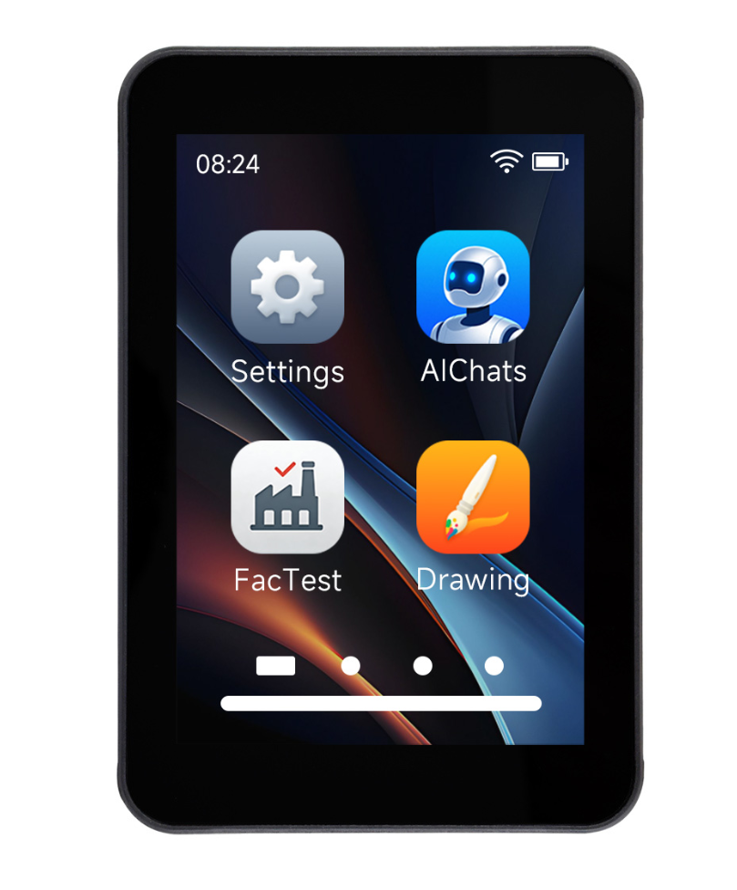

  <h1>ESP32-C5-Touch-LCD-3.5</h1>
  
<strong>3.5 英寸触摸显示开发板，支持双频 Wi-Fi 6、摄像头及音频</strong>

  
<a href="README.md">English</a> | <strong>简体中文</strong>

  

    
    
    
  

  

    <a href="https://www.waveshare.net/shop/ESP32-C5-Touch-LCD-3.5.htm">🌐 产品</a> &middot;
    <a href="firmware/">📦 固件</a> &middot;
    <a href="examples/esp-idf/">🧩 ESP-IDF</a> &middot;
    <a href="examples/arduino/examples/">🔧 Arduino</a> &middot;
    <a href="hardware/">📚 资料</a>
  

  

---

## ✨ 概述

ESP32-C5-Touch-LCD-3.5 集成 320 × 480 触摸显示、摄像头接口、音频及传感器，适用于交互界面和物联网应用。本仓库提供 Arduino、ESP-IDF 示例、出厂应用和原理图。

| 功能 | 器件 / 接口 |
| --- | --- |
| MCU | ESP32-C5, 2.4 / 5 GHz Wi-Fi 6, Bluetooth LE |
| 存储 | 32 MB Flash, 8 MB PSRAM |
| 显示 | 3.5-inch, 320 × 480, ST7796, SPI |
| 触摸 | FT6336, I2C |
| 摄像头 | BF3901（选配模组） |
| 音频 | ES8311 |
| 传感器 | QMI8658, PCF85063A, SHTC3 |
| 电源 / IO 扩展 | AXP2101 / CH32V006 |
| 扩展存储 | microSD, SPI |

## 📦 快速开始

恢复出厂功能，请下载 [firmware](firmware/) 中的合并固件，按照[烧录说明](firmware/README_ZH.md)从 **0x0** 烧录。启动后显示 12 个应用的桌面；短按 PWR 一次开机，长按 5 秒关机。应用操作见[出厂使用说明](examples/factory/USER_GUIDE_ZH.md)。

如需运行单独的示例，可在[最新 Release](https://github.com/waveshareteam/ESP32-C5-Touch-LCD-3.5/releases/latest) 提供示例固件包时下载对应的 `*-combined.zip`，解压后运行 `flash_combined.bat COMx`（Windows）或 `./flash_combined.sh /dev/ttyACMx`（Linux）。也可按下方各示例说明从源码构建。

## 🧪 示例

[出厂工程](examples/factory/)提供 Settings、AIChats、Touch Test、Photos、Weather、Music、Sensor、2048、Camera、Mic Test、Button Test 和 Display Test。

### ESP-IDF

| 示例 | 功能 |
| --- | --- |
| [02_lvgl_demo](examples/esp-idf/02_lvgl_demo/) | LVGL 显示及触摸基准测试 |
| [03_sd_card](examples/esp-idf/03_sd_card/) | microSD 卡读写验证 |
| [04_qmi8658](examples/esp-idf/04_qmi8658/) | QMI8658 加速度与角速度 |
| [05_pcf85063](examples/esp-idf/05_pcf85063/) | PCF85063A 实时时钟 |
| [06_shtc3](examples/esp-idf/06_shtc3/) | SHTC3 温湿度 |
| [07_exio](examples/esp-idf/07_exio/) | CH32V006 IO 扩展 |
| [08_AXP2101](examples/esp-idf/08_AXP2101/) | AXP2101 电源管理 |

### Arduino

| 示例 | 功能 |
| --- | --- |
| [01_exio](examples/arduino/examples/01_exio/) | CH32V006 IO 扩展 |
| [02_I2C_qmi8658](examples/arduino/examples/02_I2C_qmi8658/) | QMI8658 加速度与角速度 |
| [03_SD_Card](examples/arduino/examples/03_SD_Card/) | microSD 卡挂载及容量 |
| [04_I2C_pcf85063](examples/arduino/examples/04_I2C_pcf85063/) | PCF85063A 实时时钟 |
| [05_shtc3](examples/arduino/examples/05_shtc3/) | SHTC3 温湿度 |
| [06_axp2101_example](examples/arduino/examples/06_axp2101_example/) | AXP2101 电源及电池状态 |
| [07_lvgl_demo](examples/arduino/examples/07_lvgl_demo/) | LVGL 显示、触摸和亮度控制 |

示例依赖库随附于 [examples/arduino/libraries](examples/arduino/libraries/)。

## 🛠️ 开发环境

| 框架 | 版本 | 示例数 |
| --- | --- | ---: |
| ESP-IDF | v5.5.4 | 7 |
| Arduino-ESP32 | 3.3.10 | 7 |
| 出厂工程 / ESP-IDF | v5.5.4 | 1 |

Arduino 选择 **ESP32C5 Dev Module**，启用 PSRAM、USB CDC On Boot，Flash Mode 选择 QIO；该核心的 C5 菜单最高提供 16 MB Flash，选择 16 MB、`16M Flash (3MB APP/9.9MB FATFS)` 分区，仅使用板载 32 MB Flash 的一部分。出厂 ESP-IDF 工程按 32 MB Flash 配置。

## 📚 资料

- [原理图](hardware/schematic/)
- [产品页面](https://www.waveshare.net/shop/ESP32-C5-Touch-LCD-3.5.htm)
- [Wiki](https://docs.waveshare.net/ESP32-C5-Touch-LCD-3.5/)

## 🤝 支持

产品使用、硬件和订单问题，请联系[微雪技术支持](https://docs.waveshare.net/ESP32-C5-Touch-LCD-3.5/Technical-Support/)。

## 📄 许可证

Apache License 2.0. 详见 [LICENSE](LICENSE). 随附第三方库及组件保留各自许可证。

